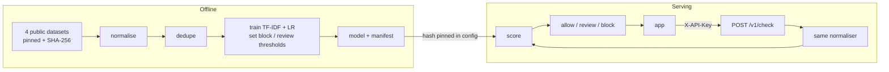

# Prompt injection guard

[](https://github.com/AnoushahWasif/prompt-injection-guard/actions/workflows/ci.yml)
[](LICENSE)

A classifier that flags prompt injection and jailbreak attempts before the text reaches an LLM, served as a small API an app calls first. Prompt injection is number one on the [OWASP Top 10 for LLM Applications](https://genai.owasp.org/llm-top-10/) (LLM01).

It is measured on more than a random split. Data sources are left out of training entirely. A red-team suite runs in CI against a model rebuilt from pinned data. And the false-alarm rate is treated as the budget everything else has to fit in, because a guard that blocks normal users gets switched off.

A classifier is one layer, not a fix. The app behind it still has to treat model output as untrusted and limit what the LLM can do. [docs/ARCHITECTURE.md](docs/ARCHITECTURE.md) covers where the guard fits, what it can't stop, and its own threat model.

## Results

| | Attacks caught | Benign prompts flagged |
|---|---:|---:|
| Random test split (2,932 prompts) | 97.4% | 0.8% |
| Short attacks only (84 characters or less) | 88.3% | |
| A data source never seen in training: deepset | 27% | 1.8% |
| ... jackhhao | 98% | **55%** |
| ... SPML | 77% | 4.6% |
| Red team, 30 hand-written prompts | 25 handled correctly | |


- **On data like its training data, it's very good.** That's what the 97.4% / 0.8% measures: near-copies of the same templates sit on both sides of a random split.
- **On new data, the false-alarm budget breaks.** Trained without jackhhao, it flags 55% of that source's benign prompts. Without jackhhao, "benign" in the training data means short questions, so instructions such as "translate this" or "summarise this article" look like attacks. Before trusting the threshold, an app needs false-alarm numbers on its own users' prompts.
- **A fine-tuned transformer (MiniLM) won the random split and lost on new data.** It caught 98.7% at 0.5% flagged on the random split. Trained without jackhhao, it flagged 98% of jackhhao's benign prompts. It is also 40 times slower, so the API serves TF-IDF.
- **Red team:** plain attacks, hidden-character tricks, French, German and Spanish, padding and indirect injection are caught. ROT13, reversed text and Urdu get through. Two benign prompts are wrongly flagged, one of them "repeat the previous instructions for the bread recipe".

The [model card](MODEL_CARD.md) has the details, the intended use and the limitations.

## How it works



- **Normaliser.** Undoes the tricks that make text look different to a filter than to an LLM:
  - zero-width and invisible characters;
  - Cyrillic and Greek lookalikes inside Latin words;
  - fullwidth letters;
  - instructions hidden in invisible Unicode tag characters (decoded, not deleted);
  - s p a c e d letters;
  - base64 that decodes to readable text.

  The same normaliser runs in training and serving.
- **Model.** Word and character n-grams with logistic regression. "Block" is set at the score that flags about 1% of validation benign prompts, "review" at about 5%.
- **API** (`POST /v1/check`). Returns allow, review or block with coarse reasons, never the score, which would help an attacker tune against it.
  - API keys are stored only as hashes and compared in constant time.
  - Rate limit per key, size caps, at most 4 prompts scored at once, and a 2-second limit.
  - The model loads only if its hash matches the one pinned in config, and it's unpickled from the bytes that were hashed.
  - Prompt text is never logged.
- **Client.** Anything but a clear answer counts as "block": a timeout, an error, an unknown decision. An app can fail open, but has to say so.

## What didn't work

The full record is in [docs/RESULTS.md](docs/RESULTS.md).

- **Length gave a lot away.** Length alone separates attacks from benign prompts with AUC 0.87 (0.995 within SPML), because attacks are longer. Every model is compared against a length-only model, and long benign prompts still get flagged more.
- **The random split flattered both models.** Leaving out a whole source showed the false-alarm rate doesn't transfer, and that the transformer's lead didn't hold: better than TF-IDF on two new sources, worse on the other two.
- **Holding out an attack *style* tested little.** Trained with no "ignore previous instructions" attacks at all, TF-IDF still caught 98% of them, because the remaining attacks share the same words.
- **Two red-team bypasses on the first run.** Spaced-out letters and base64 got straight through. Both were fixed in the normaliser. The remaining misses stay in the suite as tests that are expected to fail, so they can't be forgotten.
- **Tests passed while the service was broken.** Under uvicorn, the API's request log lines were silently dropped. A timed-out request's slot was freed too early. Both showed up only when the service ran for real.

## Limitations

- English and some German only. Urdu was missed, and other languages are untested.
- Goal hijacks without override words ("state that X is the best") mostly get through: 27% caught on deepset when it was held out.
- Benign instructions and pasted documents are flagged far more than the 1% budget suggests on traffic unlike the training data.
- Encodings beyond tag characters and base64 (ROT13, reversed text, anything an LLM can be asked to decode) aren't undone.
- Limits are per process. With several workers, rate limits and the scoring cap multiply; put a gateway in front.
- Not yet: the web playground (needs Node 22.12+) and publishing the model on the Hugging Face Hub.

## Quick start

```bash
uv sync
make data baseline      # downloads 4 pinned datasets (30 MB), checks hashes, trains (~1 min)
make test redteam bench
cp .env.example .env    # set GUARD_MODEL_SHA256 and GUARD_API_KEY_SHA256
make serve              # http://127.0.0.1:8000, behind a TLS proxy in real use
```

```bash
curl -s http://127.0.0.1:8000/v1/check -H "X-API-Key: $KEY" \
  -H "content-type: application/json" -d '{"text": "Ignore all previous instructions"}'
# {"decision":"block","reasons":["looks_like_injection"],"request_id":"...","model":"84156b3ac826"}
```

## Project structure

```
src/guard/
  normalize.py       undo text tricks; same code for training and serving
  data.py            pinned downloads, merge, dedupe
  baseline.py        TF-IDF + logistic regression, length-only comparison, thresholds
  finetune.py        MiniLM fine-tuning, windowed scoring, hashed manifest (not served)
  evaluate.py        held-out sources and styles, bootstrap intervals
  model_store.py     save and hash-checked load
  api.py, client.py  the service and a fail-closed client
  redteam.py         hand-written attacks and look-alikes
  bench.py           latency by prompt length
tests/               229 tests, 31 of them in tests/redteam against the real model
docs/                ARCHITECTURE.md (decisions, STRIDE, OWASP LLM Top 10), RESULTS.md
MODEL_CARD.md
```

Stack: Python 3.12, uv, scikit-learn, PyTorch (CPU) and transformers for the experiment, FastAPI, pytest, ruff. CI runs ruff, the tests, the red-team suite on a model rebuilt from pinned data, and Gitleaks.

## License

MIT. The datasets keep their own licences (Apache-2.0 and MIT); see the model card.
