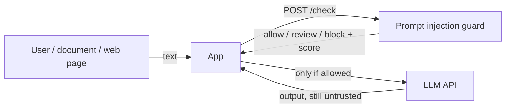
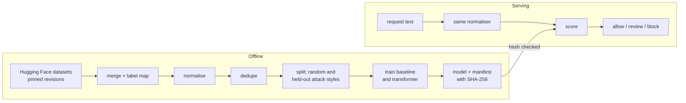

# Architecture (v1)

Written on Day 1, before any model exists. Decisions get a line at the bottom as the build changes them.

## Context

An app that sends user text to an LLM calls this guard first. The guard answers "allow", "review" or "block" with a score and the reasons it can see. The app decides what to do with that.

Injection doesn't only come from the person typing. A web page, email or PDF the app feeds to the LLM can carry instructions too (indirect injection). So "text" here means anything going into the prompt, not just the chat box.

## What a classifier can't do

This is the most important section, because a guard that looks like a fix is dangerous.

- **It will miss attacks.** Attackers rephrase, translate, encode and split instructions until something gets through. Day 5 measures how often, on attack styles the model never saw.
- **It can't make a tool-using LLM safe.** If an injection gets through, the damage depends on what the LLM is allowed to do. Least privilege for the LLM's tools, human approval for risky actions and treating output as untrusted (OWASP LLM05, LLM06) matter more than this classifier.
- **It doesn't see the conversation.** It scores one piece of text. Attacks spread over several turns are out of scope for v1.
- **Encoded payloads** (base64, rot13, hex) aren't decoded in v1. That's a known gap for the red-team suite to measure.

## Components

| Component | Where | What it does |
|-----------|-------|--------------|
| Normaliser | `src/guard/normalize.py` | Undoes text tricks before scoring: decodes Unicode tag smuggling, removes zero-width and bidi characters, folds fullwidth letters, fixes Cyrillic/Greek lookalikes inside Latin words. Reports what it found (Day 1) |
| Data | `src/guard/data.py` | Downloads public datasets from Hugging Face at pinned revisions, merges them into one schema, dedupes on normalised text (Day 2) |
| Baseline | `src/guard/baseline.py` | TF-IDF + logistic regression: fast, explainable, the bar the transformer must beat (Day 3) |
| Transformer | `src/guard/finetune.py` | A small model (DistilBERT or DeBERTa-small) fine-tuned on CPU or Colab (Day 4) |
| Evaluation | `src/guard/evaluate.py` | Held-out attack *styles* as well as a random split; error analysis (Day 5) |
| Guard API | `src/guard/api.py` | FastAPI `POST /check`, plus middleware an app can drop in front of its LLM route (Day 6) |
| Playground | `web/` | Next.js page: type a prompt, see the score and why (Day 7) |
| Red-team suite | `tests/redteam/` | Known bypasses as pytest cases, plus a latency benchmark (Day 8) |

## Data flow

## Datasets (Day 2)

| Source | Licence | Rows kept | Attacks |
|--------|---------|-----------|---------|
| deepset/prompt-injections | Apache-2.0 | 662 | 40% |
| jackhhao/jailbreak-classification | Apache-2.0 | 1,970 | 33% |
| Lakera/gandalf_ignore_instructions | MIT | 999 | 100% |
| reshabhs/SPML_Chatbot_Prompt_Injection (user message only) | MIT | 15,913 | 79% |

Each file is pinned to a commit and a SHA-256. `xTRam1/safe-guard-prompt-injection` was left out: no licence listed. Text length alone separates the classes with AUC 0.87 overall and 0.995 in SPML, so every model is compared against a length-only baseline.

## Decisions

| # | Decision | Why |
|---|----------|-----|
| 1 | Three answers (allow / review / block), not two | A single threshold forces a choice between missed attacks and blocked users. "Review" lets an app log, add friction or strip tools for the grey zone |
| 2 | One normaliser shared by training and serving, run before scoring | If training saw normalised text and the API didn't (or the reverse), the model would be scored on inputs it never learned. Same lesson as the phishing project's punycode fix |
| 3 | Tag-character smuggling is decoded into visible text, not deleted | Deleting it would hide the attack from the model too. Decoding shows the model what the LLM would have read |
| 4 | Mixed-script fixes only inside words that also contain Latin letters | Fixing every Cyrillic letter would wreck real Russian text and create false alarms |
| 5 | Evaluate on held-out attack styles, not only a random split | Near-duplicate prompts are everywhere in these datasets; a random split mostly tests memory |
| 6 | The guard API fails **closed** by default: if it can't score (error, timeout), the middleware blocks | The opposite of the phishing extension, which fails open. There a failure would stop all browsing; here it stops one LLM call, and letting an unchecked prompt reach a tool-using LLM is the worse outcome. Configurable per app |
| 7 | Inputs over 20,000 characters are refused before any work | Normalising and tokenising are linear but not free; a cap keeps one request from tying up the service |
| 8 | Model files are checked by SHA-256 before loading | Same as the other projects: a pickle or a model repo with custom code runs code on load (OWASP LLM03) |
| 9 | Prompts with conflicting labels across sources are dropped, not resolved (Day 2) | Guessing would put a wrong label into training. There were none, but the check stays for new sources |
| 10 | Only SPML's user message is kept, not its system prompt (Day 2) | The guard sees what a user sends. Training on system prompts would teach it things it never sees at serving time |

## Threat model of the guard itself (STRIDE)

| STRIDE | Threat | Mitigation |
|--------|--------|------------|
| **Spoofing** | Something other than the app calls the guard to probe it for free | API key per calling app, checked in constant time; rate limit per key |
| **Tampering** | Evasion: the text is crafted to score low (hidden characters, lookalikes, encodings, typos) | Normaliser before scoring; held-out style evaluation; red-team suite that grows with every bypass found |
| **Tampering** | Poisoned training data (mislabelled attacks in a public dataset) | Pinned revisions, recorded sources, dedupe, and a look at disagreements between datasets on Day 2 (OWASP LLM04) |
| **Tampering** | A swapped model file | SHA-256 check before loading |
| **Repudiation** | An app claims the guard allowed something it blocked | Each decision logged with request id, score and model version, but not the prompt text (see next row) |
| **Information disclosure** | Prompts contain personal or secret data and end up in guard logs | Prompt text is never logged; only length, score, decision and which signals fired |
| **Information disclosure** | Scores leak how close an attack is to passing, so attackers can tune against it | `/check` returns the decision and coarse reasons to the app; the exact score only goes to logs or a debug mode that is off in production |
| **Denial of service** | Huge or many requests make the guard slow, and a slow guard fails closed, blocking the app | Size cap, rate limit, timeouts; latency benchmarked on Day 8 |
| **Elevation of privilege** | The guard is treated as the only control, so an LLM gets powerful tools "because inputs are checked" | Stated in "What a classifier can't do" and the README: the guard is one layer |

## OWASP Top 10 for LLM Applications (2025): notes

How each risk relates to this project. "Main" means the guard is built for it; "partly" means it helps a little; "no" means another control is needed.

| # | Risk | In short | This project |
|---|------|----------|--------------|
| LLM01 | Prompt injection | Text that changes what the model does, typed directly or hidden in content the app feeds it (indirect) | **Main.** Detects common direct and indirect injection phrasing and the character tricks used to hide it |
| LLM02 | Sensitive information disclosure | The model reveals personal data, secrets or other users' data | Partly: many injections aim to extract data, so catching them helps. The guard itself never logs prompts |
| LLM03 | Supply chain | Compromised models, datasets or libraries | Applies to the guard: pinned dataset revisions, locked dependencies, model hash check, dependency audit in CI |
| LLM04 | Data and model poisoning | Training data altered to plant a backdoor or bias | Applies to the guard's own training data: public datasets are recorded, pinned and checked for label disagreements |
| LLM05 | Improper output handling | LLM output used unchecked in HTML, SQL, shell or another system | No. The calling app must treat output as untrusted |
| LLM06 | Excessive agency | The LLM has more tools, permissions or autonomy than it needs | No, and this is what decides how bad a missed injection is |
| LLM07 | System prompt leakage | Secrets or rules in the system prompt get revealed | Partly: "repeat your instructions" style prompts are in the training data. The real fix is not putting secrets in system prompts |
| LLM08 | Vector and embedding weaknesses | RAG stores that leak across users or get poisoned documents | Partly: retrieved documents can be checked with the same guard before they're added to the prompt |
| LLM09 | Misinformation | Confident wrong answers, invented packages or facts | No |
| LLM10 | Unbounded consumption | Requests that run up cost or exhaust the service | Applies to the guard: size cap, rate limit, and it should be cheaper per call than the LLM it protects |
